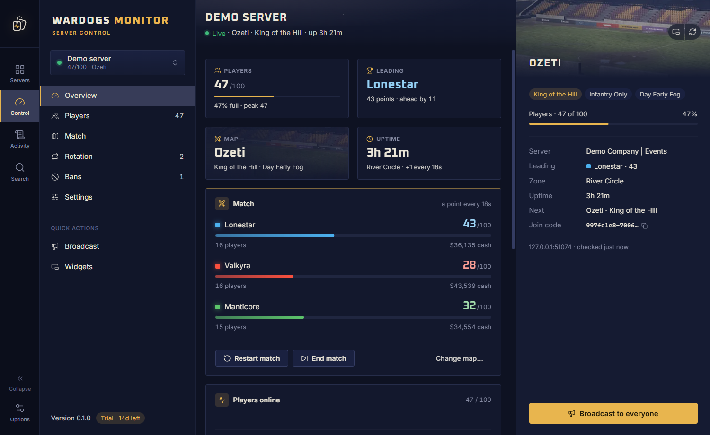
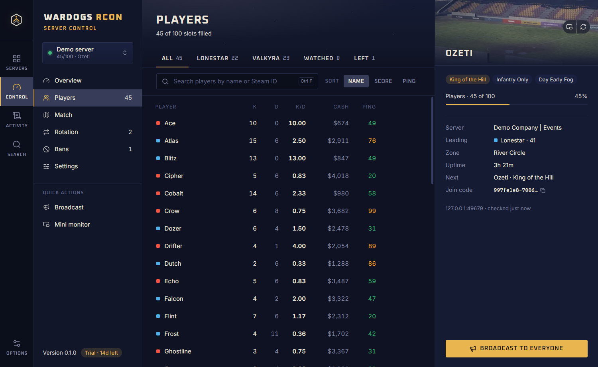
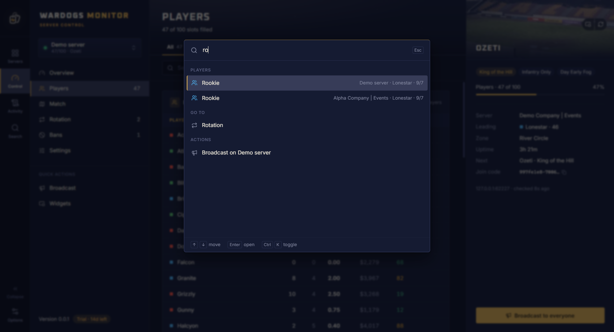
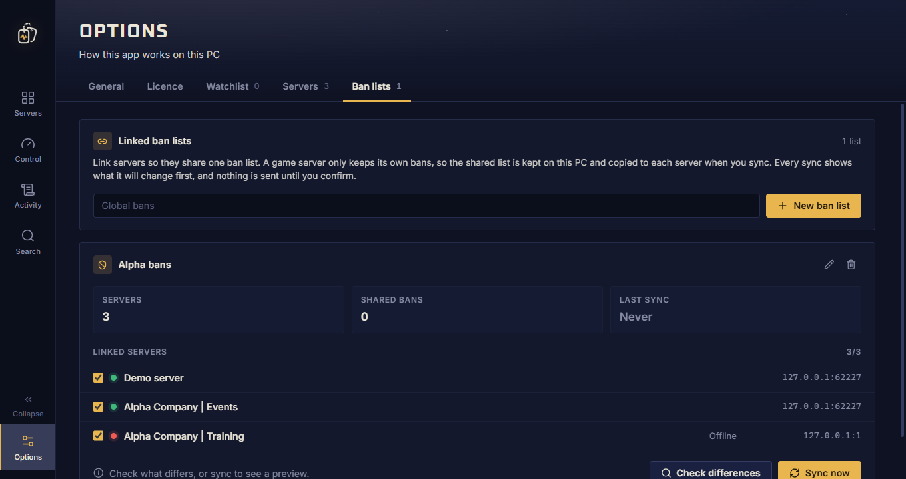
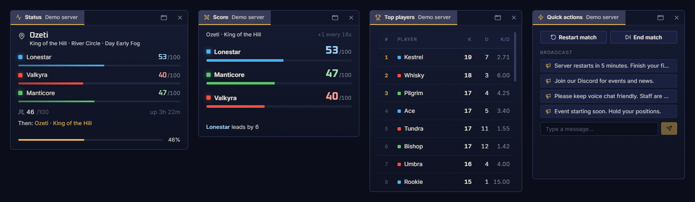

# Wardogs Monitor

**Free desktop control panel for Wardogs dedicated servers** ([wardogsmonitor.com](https://wardogsmonitor.com)).

Monitor, moderate, and manage as many Wardogs dedicated servers as you run from one fast Windows desktop app: live scores and players, kicks and bans, linked ban lists, match controls, map rotations, server settings, and always-on-top overlay widgets. No account, no subscription, and no telemetry.

[](https://github.com/CodeWithDennis/wardogs-monitor/actions/workflows/build.yml)
[](https://github.com/CodeWithDennis/wardogs-monitor/releases)
[-0078D6)](#download-and-install)
[-e8b54e)](LICENSE)


## Contents

- [Features](#features)
- [Screenshots](#screenshots)
- [Download and install](#download-and-install)
- [Connecting a server](#connecting-a-server)
- [Keyboard shortcuts](#keyboard-shortcuts)
- [How it works](#how-it-works)
- [Security and privacy](#security-and-privacy)
- [Development](#development)
- [Building and releasing](#building-and-releasing)
- [Project structure](#project-structure)
- [Contributing](#contributing)
- [Disclaimer](#disclaimer)
- [License](#license)

## Features

### Multi-server dashboard
- **Server cards**: every saved server at a glance with map artwork, online status, player count, faction score race, and address.
- **Quick switching and filtering**: jump between servers from the top-left switcher, filter cards by online or offline status, and search by name or address.
- **Non-destructive management**: edit or remove servers from the `⋯` menu or right-click menu. Removing a server only removes it from the app; the server itself is never touched.

### Per-server control
- **Overview**: live player and faction tiles, score race, player-count chart over time, top players, recent activity, and a broadcast box with saved message templates.
- **Players**: filter by faction, sort by clicking any column header (name, kills, deaths, K/D, cash, ping), and search by name or Steam ID. Right-click any player to message, change faction, kill, kick, ban, watch, or copy their name or Steam ID. The **Left** tab keeps recently disconnected players so they can still be moderated.
- **Match**: restart or end the current match, or travel straight to any map, game mode, modifier, lighting, and starting zone.
- **Rotation**: drag-and-drop match playlist with toggleable enabled state and ordered or random mode.
- **Bans**: view and lift active bans, or ban an offline Steam ID directly.
- **Settings**: edit join password, reserved slots and Steam IDs, player limits, level and cash bounds, score period, team balance, server name, and banner with built-in game-limit validation.

### Moderation and desktop tools
- **Search everything (`Ctrl+K`)**: command palette across players on every server (including recently left players), saved servers, views, and actions.
- **Linked ban lists**: group servers to share a single ban list (**Options → Ban lists**). Differences are previewed and only applied after you confirm; unbans made in the app can be lifted across every linked server.
- **Watchlist and desktop alerts**: star players with notes to get Windows notifications when they join any server, plus alerts when a server goes offline or comes back online.
- **Always-on-top widgets**: open as many overlay windows as you want over your game—**Status**, **Score**, **Top players**, and **Quick actions**—with adjustable opacity and saved positions across restarts.
- **System tray mode**: runs quietly in the notification area with a live status tooltip and quick server/widget menu, optional close-to-tray, minimise-to-tray, start hidden, and launch with Windows.
- **Activity log**: local per-server audit trail of every action taken from the app, including failures.
- **Themes and zoom**: 24 themes (Midnight, Carbon, Graphite, Blackout, Nord, Dracula, Gruvbox, Tokyo Night, and more), 4 accent colours, and full zoom support (`Ctrl +` / `Ctrl −` / `Ctrl 0` or `Ctrl + scroll`).
- **Built-in demo server**: simulated three-faction match running locally so you can test every feature safely without touching a live server.

## Screenshots

| Overview | Players |
| --- | --- |
|  |  |
| **Match** | **Search everything (Ctrl+K)** |
|  |  |
| **Themes** | **Linked ban lists** |
|  |  |

Always-on-top widgets and collapsed icon rail:




## Download and install

Download the latest Windows build from the [Releases](https://github.com/CodeWithDennis/wardogs-monitor/releases) page (or from the artifacts of the latest [Build workflow run](https://github.com/CodeWithDennis/wardogs-monitor/actions/workflows/build.yml)):

- **`Wardogs-Monitor-Setup-x.y.z.exe`** — standard installer (choose install folder, adds a Start menu shortcut).
- **`Wardogs-Monitor-x.y.z-portable.exe`** — portable executable that runs without installation.

> **Windows SmartScreen:** Builds are currently unsigned, so Windows SmartScreen may show a warning on first launch. Click **More info → Run anyway** to proceed, or build the app yourself from source.

**Requirements:** Windows 10 or Windows 11 (64-bit).

## Connecting a server

1. Click **Add server**.
2. Enter your server's RCON IP/hostname and port from your game host's panel.
   - On BisectHosting, use the panel's RCON IP and port (for example `165.217.136.57:9001`), not the internal port `47990` in `ServerSettings.ini`.
   - Pasting `ip:port` into the address field automatically splits and fills both inputs.
3. Enter the RCON password from the `[/Script/WDRCON.WDRCONSettings]` section of `ServerSettings.ini`.

Wardogs Monitor verifies the connection and password before saving the server.

## Keyboard shortcuts

| Shortcut | Action |
| --- | --- |
| `Ctrl+K` | Open Search everything (command palette) |
| `Ctrl+H` | Show all servers as cards |
| `Ctrl+1` … `Ctrl+6` | Switch between Overview, Players, Match, Rotation, Bans, and Settings |
| `Ctrl+F` | Focus the search box in the current view |
| `F5` or `Ctrl+R` | Refresh the current server immediately |
| `Ctrl +` / `Ctrl −` / `Ctrl 0` | Zoom in, zoom out, or reset zoom (`Ctrl + mouse wheel` works too) |
| `↑` / `↓` | Move through players |
| `Right-click` | Open player actions menu |
| `Esc` | Close the open player panel, menu, or dialog |
| `Ctrl+Enter` | Send a message |

## How it works

Wardogs dedicated servers expose an HTTP RCON API at `http://host:port/v1`, authenticated with the RCON password as a Bearer token.

| Endpoint | Purpose |
| --- | --- |
| `GET status`, `players`, `health` | Live status, player list, and uptime polling |
| `GET bans`, `rotation`, `server-id`, `sponsor` | Active bans, map rotation, join code, and banner |
| `GET catalog/maps`, `catalog/lightings`, `catalog/experiences`, `catalog/maps/{map}/…` | Map, game mode, modifier, lighting, and zone pickers |
| `GET config` / `PUT config` (with `If-Match`) | Reading and updating `ServerSettings.ini` |
| `POST match/end`, `match/restart`, `match/map`, `broadcast`, `players/{id}/…`, `PATCH players/{id}`, `POST/DELETE bans` | Match, messaging, moderation, and ban actions |

Reads retry once on a dropped connection; write actions never retry automatically so kicks, bans, and broadcasts are never sent twice. Config updates rewrite only changed keys and pass the `If-Match` revision header so concurrent admins never silently overwrite each other.

## Security and privacy

- **Encrypted credentials**: RCON passwords are encrypted on disk using Windows DPAPI (Electron `safeStorage`) tied to your Windows user account and never enter the renderer process.
- **Config isolation**: the raw `ServerSettings.ini` document (which includes the RCON password) stays strictly in Electron's main process; the UI only receives the parsed editable values.
- **Hardened Electron runtime**: renderer windows run sandboxed with `contextIsolation: true`, `nodeIntegration: false`, a strict Content Security Policy, packaged-build Electron fuses (`runAsNode: false`, `onlyLoadAppFromAsar: true`, ASAR integrity validation), and an external-link allowlist limited to Steam profiles and `wardogsmonitor.com`.
- **No telemetry**: the app makes zero background calls to external services. Network traffic goes strictly between your PC and your configured Wardogs servers.
- **Transport note**: the Wardogs dedicated server RCON API uses plain HTTP, so credentials travel unencrypted between your PC and your game server, as with any RCON client for the game.

## Development

Requires **Node.js 22+** and **Windows** (credentials rely on Windows DPAPI).

```bash
npm install
npm run dev           # Start Vite with hot reload and Electron
npm run mock          # Run a local mock Wardogs server on 127.0.0.1:47990 (password: "mock-secret")
npm test              # Run unit tests (config editor, RCON client, preferences, ban lists, tray, widgets)
npm run typecheck     # Run vue-tsc type checking
npm run check         # Run typecheck and unit tests together
npm run screenshots   # Capture views against the demo server using a temporary data folder
npm run dist          # Build Windows installer and portable exe into release/
```

> **npm 11 note:** npm 11 may prompt before running lifecycle install scripts. If Electron's binary was skipped (`node_modules/electron/dist` is missing), run `node node_modules/electron/install.js`.

## Building and releasing

GitHub Actions ([`.github/workflows/build.yml`](.github/workflows/build.yml)) runs on every push to `main` and every pull request on `windows-latest`: it installs dependencies, typechecks, runs tests, and builds both the NSIS installer and portable executable as workflow artifacts.

To publish a release, make sure `version` in `package.json` matches the tag and push a `v*` tag:

```bash
npm version patch   # or minor / major
git push --follow-tags
```

The workflow verifies that the tag matches `package.json`, builds both executables, and publishes them to GitHub Releases with generated release notes.

## Project structure

```
brand.json                  Product name, tagline, app ID, data folder, website
electron/
  main.mjs                  Windows, tray, IPC handlers, zoom, data folder migration
  preload.cjs               Sandboxed IPC bridge exposed to the renderer
  rcon.mjs                  Wardogs HTTP RCON client
  config.mjs                ServerSettings.ini parser, writer, and validation limits
  service.mjs               Cached server reads, actions, and linked ban-list syncing
  store.mjs                 Saved servers (DPAPI-encrypted passwords), ban lists, activity log
  preferences.mjs           User preferences, defaults, and migrations
  banlists.mjs              Linked ban-list planning, tombstones, and sync logic
  tray-status.mjs           System tray tooltip and menu formatting
  widgets.mjs               Overlay widget specs and multi-display placement
mock/
  wardogs-mock.mjs          Mock Wardogs RCON server used for demo mode and tests
scripts/
  dev.mjs                   Development runner (Vite + Electron)
  screenshots.mjs           Throwaway-profile screenshot runner
  capture.mjs               Automated screenshot, tray, and click checks
  make-icon.mjs             Generates build/icon.png and build/tray/ icons from mark.svg
src/
  App.vue, main.ts          Vue entry point (main panel and widget windows)
  components/               Shell, rail, sidebar, switcher, cards, dialogs, widgets, palette
  views/                    Servers, Overview, Players, Match, Rotation, Bans, Settings, Activity, Options
  lib/                      Reactive store, themes, brand config, formatting, maps, watchlist, tray
  assets/                   Map artwork, Oxanium font, brand SVG mark
tests/                      node:test unit test suites
```

## Contributing

Bug reports, feature ideas, and pull requests to this repository are welcome!

1. Fork this repository on GitHub and create a feature or fix branch.
2. Keep commits clear and follow [Conventional Commits](https://www.conventionalcommits.org/).
3. Run `npm run check` before opening a pull request.
4. Open a pull request against `main`.

Please note that forks are permitted solely for testing locally and contributing back to this repository—see [License](#license) below. By submitting a pull request or patch, you agree to the contribution terms in Section 4 of [`LICENSE`](LICENSE).

## Disclaimer

Wardogs Monitor is an independent, unofficial community tool and is **not** affiliated with, endorsed by, or sponsored by the developers of Wardogs. "Wardogs" and the map imagery in `src/assets/maps/` belong to their respective owners.

This software is provided **"AS IS"**, without warranty of any kind. You use it at your own risk; the author is not responsible for server downtime, configuration errors, unintended kicks or bans, or data loss.

## License

**Source-Available — Free to Use.** Copyright © 2026 CodeWithDennis. All rights reserved.

- **You may** download, install, and use Wardogs Monitor for free, inspect the source code, build it locally for your own use, and fork/modify it to contribute fixes or improvements back to this repository.
- **You may not** copy, rebrand, repackage, publish, sell, or distribute your own modified or unmodified versions or forks of this software to others.

See [`LICENSE`](LICENSE) for the full terms, warranty disclaimer, limitation of liability, and third-party license attributions.
