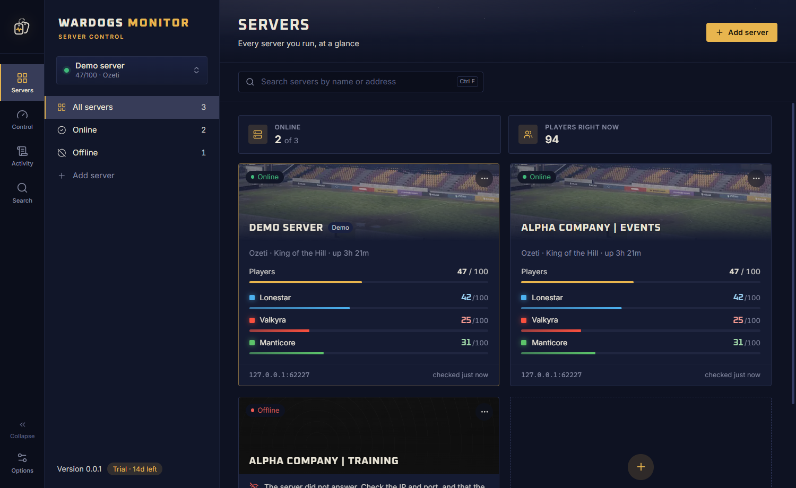
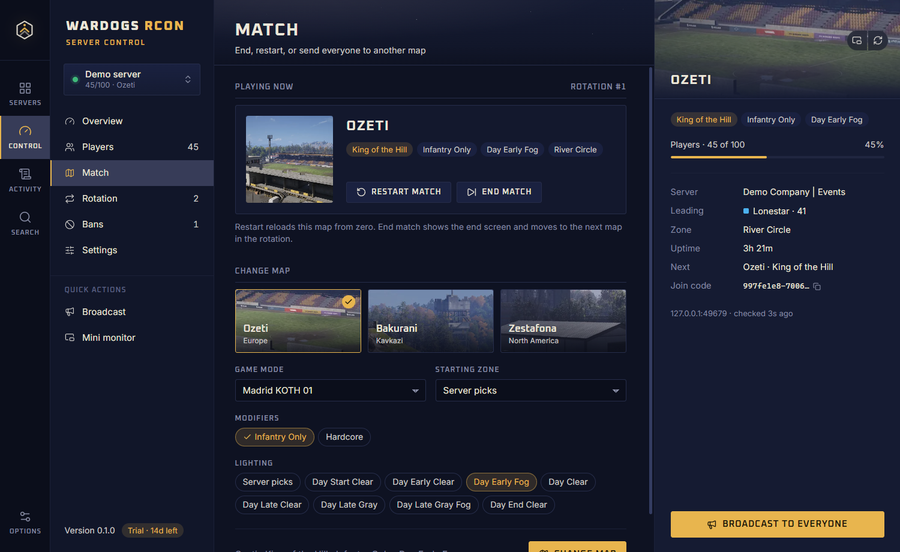
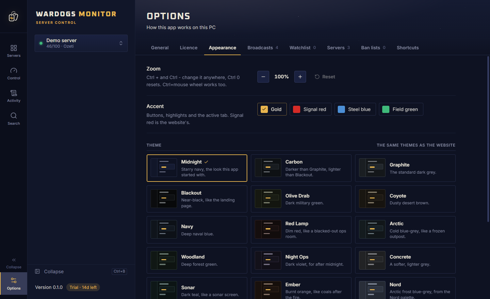
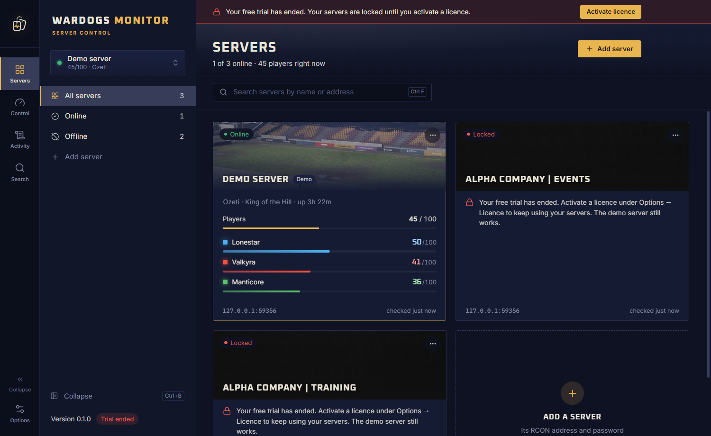
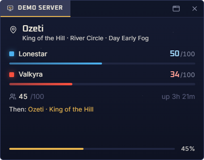
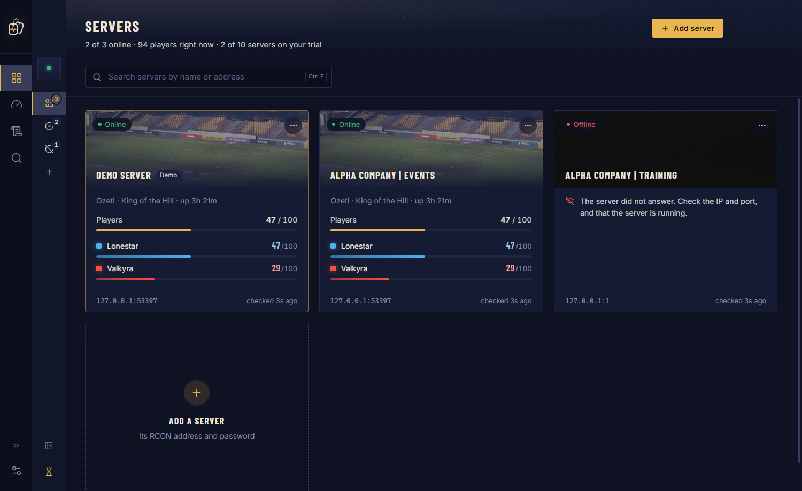

# Wardogs Monitor

**Server control for Wardogs** ([wardogsmonitor.com](https://wardogsmonitor.com)). A Windows desktop app to monitor, moderate and run Wardogs dedicated servers: live scores and players, kicks and bans, the match and its map rotation, and every server setting, for as many servers as you run.

[](https://github.com/CodeWithDennis/wardogs-monitor/actions/workflows/build.yml)



## Contents

- [Features](#features)
- [Screenshots](#screenshots)
- [Install](#install)
- [Connecting a server](#connecting-a-server)
- [Keyboard shortcuts](#keyboard-shortcuts)
- [Development](#development)
- [Building and releasing](#building-and-releasing)
- [Licensing: selling the app](#licensing-selling-the-app)
- [Renaming and branding](#renaming-and-branding)
- [How it works](#how-it-works)
- [Project structure](#project-structure)
- [Security and privacy](#security-and-privacy)
- [Before selling](#before-selling)

## Features

**Servers**
- Every saved server as a card: map picture, online status, players, score race and address.
- A switcher at the top left jumps between servers. Filter the cards by online or offline, and search by name or address.
- Edit or remove a server from its ⋯ menu or a right-click. Removing only makes the app forget it; the server is not touched.

**One server**
- **Overview**: the live score race, a broadcast box with ready-made messages, players over time, top players and recent activity.
- **Players**: filter by faction, sort by name, score or ping, and search by name or Steam ID. Right-click a player to message, move faction, kill, kick, ban, watch, or copy their name or Steam ID. The **Left** tab keeps players who just quit, so they can still be banned.
- **Match**: restart or end the match, or travel to any map, game mode, modifier, lighting and starting zone.
- **Rotation**: a drag-and-drop playlist of matches, on or off, ordered or random.
- **Bans**: list and lift bans, or ban a Steam ID that is offline.
- **Settings**: join password, reserved spots and players, player slots, level and cash limits, score period, team balance, server name and banner. Values stay within the limits the game accepts.

**Everywhere**
- **Search everything (Ctrl+K)**: players on every server by name or Steam ID, players who just left, servers, pages and actions.
- **Watchlist**: star a player to get a Windows notification whenever they join any server, with a note on why you watch them.
- **Alerts**: a notification when a server goes down or comes back.
- **Linked ban lists**: link servers into one shared ban list (Options → Ban lists). On start, or with Sync, the app shows what differs per server and adds the missing bans only after you confirm; unbans made in the app apply to every linked server.
- **Licence**: one plan, €9.99 a month or €99 a year, with unlimited servers on up to 3 PCs. The key carries the limits, so the app enforces them offline too. The 14-day trial is unlimited.
- **Mini monitor**: a small always-on-top window with the map, score race and player count, to keep over the game.
- **Activity log**: every action taken from the app, per server, with failures.
- **Themes**: 24 themes (Midnight by default, plus Carbon, Graphite, Blackout, Nord, Dracula, Gruvbox, Tokyo Night and more) and four accent colours. Zoom with Ctrl + / Ctrl − / Ctrl 0 or Ctrl + mouse wheel.
- **Layout**: the sidebar folds to icons (Ctrl+B), the rail switches to icons only, and the right-hand details fold to a thin strip (Ctrl+J). Click a players column header to sort by it.
- **Demo server**: a pretend server that plays a match on its own, so every control can be tried safely.

## Screenshots

| Overview | Players |
| --- | --- |
|  |  |
| **Match** | **Search everything (Ctrl+K)** |
|  |  |
| **Themes** | **Trial ended, servers locked** |
|  |  |

The mini monitor, and the window with the sidebar hidden and the rail on icons only:





## Install

Download the latest build from the [Releases](https://github.com/CodeWithDennis/wardogs-monitor/releases) page, or from the artifacts of the latest [Build run](https://github.com/CodeWithDennis/wardogs-monitor/actions/workflows/build.yml):

- `Wardogs Monitor Setup x.y.z.exe`: an installer (choose the folder, adds a Start menu entry).
- `Wardogs Monitor x.y.z.exe`: a portable exe that runs without installing.

The builds are not code-signed yet, so Windows SmartScreen may warn on first start: choose **More info → Run anyway**.

Requires Windows 10 or 11 (64-bit).

## Connecting a server

1. Click **Add server**.
2. Enter the RCON address and port from your host's panel. On BisectHosting, that is the panel's IP and port (for example `165.217.136.57:9001`), not the internal port 47990 in the ini file. Pasting `ip:port` into the address field fills in both.
3. Enter the RCON password from the `[/Script/WDRCON.WDRCONSettings]` section of `ServerSettings.ini`.

The app checks that the server answers with that password before saving it.

## Keyboard shortcuts

| Keys | What it does |
| --- | --- |
| Ctrl+K | Search everything |
| Ctrl+H | All servers as cards |
| Ctrl+B | Fold the sidebar to icons (the rail's « button does the same for the rail) |
| Ctrl+J | Fold the right-hand details to a thin strip |
| Ctrl+1 … Ctrl+6 | Overview, Players, Match, Rotation, Bans, Settings |
| Ctrl+F | Jump to the page's search box |
| F5 or Ctrl+R | Read the server again now |
| Ctrl + / Ctrl − / Ctrl 0 | Zoom in, out, reset (Ctrl + mouse wheel works too) |
| ↑ ↓ | Move through players |
| Right-click | Player actions, anywhere a player is listed |
| Esc | Close the open player, menu or dialog |
| Ctrl+Enter | Send a message |

## Development

Requires Node.js 22 or newer and Windows (the app uses Windows DPAPI for passwords).

```bash
npm install
npm run dev           # Vite with hot reload, and Electron pointed at it
npm run mock          # a pretend Wardogs server on 127.0.0.1:47990, password "mock-secret"
npm test              # unit tests: config editor, RCON client, preferences, licences
npm run typecheck     # vue-tsc
npm run check         # typecheck and tests together
npm run screenshots   # captures every page against the demo server, with a throwaway data folder
npm run dist          # release/: the installer and the portable exe
```

npm 11 asks before running install scripts. If Electron's binary was not downloaded (`node_modules/electron/dist` is missing), run `node node_modules/electron/install.js`.

Screenshot mode (`npm run screenshots [folder]`) never touches your own data: it runs with a temporary data folder and the demo server.

## Building and releasing

GitHub Actions ([`.github/workflows/build.yml`](.github/workflows/build.yml)) runs on every push to `main` and every pull request. It installs, typechecks, runs the tests and builds the installer and portable exe on `windows-latest`. The builds are kept as the run's artifacts.

To publish a release:

```bash
npm version patch     # or minor / major: bumps package.json and makes a git tag
git push --follow-tags
```

A pushed `v*` tag makes the workflow attach both exes to a GitHub release with generated release notes.

Code signing: the workflow builds unsigned (`CSC_IDENTITY_AUTO_DISCOVERY=false`). To sign, add the certificate as `CSC_LINK` (base64 .pfx) and `CSC_KEY_PASSWORD` repository secrets, pass them to the build step, and remove that variable.

## Licensing: selling the app

The app runs a **14-day free trial** from its first start (`trialDays` in `brand.json`), for up to 10 servers. After that, real servers are locked until a licence key is activated; the demo server always works and never counts. The lock is enforced in Electron's main process, not just hidden in the window.

Every plan has every feature; plans differ in how many servers they run: Basic 3, Clan 5, Community 10, Alliance unlimited. Servers beyond the limit are locked, never deleted: the first ones in the saved order (`servers.json`, the order the switcher shows) stay usable, and adding one more is refused until the user upgrades or removes one.

A licence key is the licence itself (name, email, plan, number of servers, optional end date), signed with an Ed25519 private key. The app ships only the public key, so it can check keys offline but can never make them. Editing a key, or signing one with another private key, makes it invalid. Keys look like `WDM-<licence>.<signature>`.

```bash
node scripts/license/keygen.mjs      # once: makes license-signing/private.pem and electron/license-public-key.mjs
node scripts/license/issue.mjs --name "Jane Doe" --email jane@example.com --plan clan --servers 5   # never ends
node scripts/license/issue.mjs --name "Jane Doe" --email jane@example.com --days 365         # one year
```

- **Back up `license-signing/private.pem`** somewhere safe and never share or commit it. It is git-ignored and never packaged. Losing it means new keys won't work in the app you already shipped; leaking it lets anyone make keys. Running `keygen.mjs --force` makes a new pair and invalidates every key sold so far.
- Customers paste their key under **Options → Licence**. **Remove from this PC** frees it to move to another PC.
- Selling through Lemon Squeezy, Gumroad or Paddle works by issuing a key when an order comes in, by hand or from their webhook with `issue.mjs`.
- The trial start lives in the app's data folder, so deleting that folder restarts the trial.
- **Online check** against [wardogsmonitor.com](https://wardogsmonitor.com)'s licence API (`${website}/api/v1`, or `PANEL_LICENSE_API`, e.g. `https://wardogs-monitor.test/api/v1`; `off` disables it). Activating checks the key offline, then `POST /licenses/activate` takes a seat for this PC; if the site is down it activates offline and confirms later. On start and every 12 hours `POST /licenses/validate` swaps in a re-signed key (renewals, plan changes) and stores the signed status token (`WDMS-…`). A revoked licence is removed; when the site cannot be reached the app keeps working until the last token's `valid_until`, or on the key alone if it never got one. **Remove from this PC** also calls `POST /licenses/deactivate`. Only the key, a random device ID (`device.json`) and the PC's name are sent.

## Renaming and branding

The product name, tagline, licence key prefix, trial length, website and support email live in [`brand.json`](brand.json). When renaming, also change `productName` in `package.json` and the `<title>` in `index.html`.

The data folder (`%APPDATA%\Wardogs Monitor`) is set by `dataFolder` and stays put across renames; `previousDataFolders` lists older folders whose saved servers move over on first start.

The app icon (`build/icon.png`) is rendered from `src/assets/brand/mark.svg` with `npx electron scripts/make-icon.mjs`.

## How it works

Wardogs dedicated servers expose an HTTP RCON API at `http://host:port/v1`, with the RCON password as a Bearer token. The app reads:

| Endpoint | Used for |
| --- | --- |
| `GET status`, `players`, `health` | The live reading, every few seconds |
| `GET bans`, `rotation`, `server-id`, `sponsor` | Bans, rotation, join code and banner |
| `GET catalog/maps`, `catalog/lightings`, `catalog/experiences`, `catalog/maps/{map}/…` | The map, mode, lighting and zone pickers |
| `GET config` / `PUT config` (with `If-Match`) | Settings and rotation, edited in `ServerSettings.ini` |

It writes with `POST match/end`, `match/restart` and `match/map`, `POST broadcast`, `POST players/{id}/kick|kill|message`, `PATCH players/{id}` (faction) and `POST/DELETE bans`.

Reads retry once on a dropped connection; writes never retry, so a kick or broadcast is never sent twice. Settings are saved by rewriting only the lines that changed in the config document, and the server refuses a save made against a stale revision, so two admins never overwrite each other.

## Project structure

```
brand.json                  product name, tagline, licence prefix, trial length
electron/
  main.mjs                  windows, IPC, zoom, the licence gate, the data folder
  preload.cjs               the only bridge to the window (no passwords cross it)
  rcon.mjs                  the Wardogs RCON HTTP client
  config.mjs                ServerSettings.ini editor and settings limits
  service.mjs               live readings, catalog, settings and actions, with caching
  store.mjs                 saved servers (DPAPI-encrypted passwords) and the activity log
  preferences.mjs           preferences, defaults and migrations
  license-core.mjs          licence key signing, checking, trial maths and server limits
  license-online.mjs        the website's licence API: activate, validate, deactivate
  license.mjs               the licence, trial and device ID on this PC
mock/wardogs-mock.mjs       the pretend server behind the demo and the tests
scripts/
  dev.mjs                   Vite + Electron for development
  license/                  keygen.mjs and issue.mjs for selling
  screenshots.mjs, capture.mjs   screenshot mode
  make-icon.mjs             renders build/icon.png
src/
  App.vue, main.ts          the window (main panel or mini monitor)
  components/               shell, rail, sidebar, switcher, cards, dialogs, palette…
  views/                    Servers, Overview, Players, Match, Rotation, Bans, Settings, Activity, Options
  lib/                      store, themes, brand, formatting, maps, watchlist
  assets/                   map pictures, fonts, brand mark
tests/                      node:test suites
```

## Security and privacy

- RCON passwords are encrypted with Windows DPAPI (Electron `safeStorage`) for the current Windows account, and never reach the window.
- The config document, which contains the RCON password, stays in the main process; the window only ever sees the values it edits.
- The window runs sandboxed with context isolation and a strict content security policy. Only Steam profiles and the product website open in the browser.
- Nothing is sent anywhere except to your own servers and, for a licence, the website's licence API: only the key, a random ID for this PC and the PC's name. Keys and the website's status tokens are checked offline with the public key.
- The Wardogs RCON API itself is plain HTTP, so the password travels unencrypted between your PC and the server, as it does with every RCON tool for this game.

## Before selling

- **The name**: "Wardogs" is the game's trademark, and the developer runs `rcon.wardogs.com`. Get the developer's permission before selling under this name, or rename the app (see [Renaming and branding](#renaming-and-branding)).
- **The map pictures** in `src/assets/maps` are screenshots from the game; they need the developer's permission too, or replacing with your own artwork.
- **Code signing**: a certificate removes the SmartScreen warning and builds trust with buyers.
- **Support email**: fill in `supportEmail` in `brand.json`. The website is set to wardogsmonitor.com, so the Licence page shows a **Buy a licence** button.

## Licence

Proprietary. Copyright © 2026 CodeWithDennis. All rights reserved. See [LICENSE](LICENSE).
